# OpenXComZX

Порт **OpenXcom** (X-COM: UFO Defense и Terror from the Deep) на **TS-Config** —
ZX Evolution / Pentevo: Z80 до 14 МГц, 4 МБ страничной памяти, аппаратные тайлы,
спрайты и DMA. Музыка — AY / TurboSound / YM2203, опционально плата OPL3 (YMF262).

Порт сильно адаптирован под железо, но повторяет оригинал: те же правила, те же
формулы, те же мелочи интерфейса. Данные берутся из копии игры пользователя —
их конвертирует утилита на ПК, в репозитории оригинальных данных нет.

## Как это выглядит

Кадры 320×200 из эмулятора, увеличены вдвое без сглаживания. Игра — Terror from the
Deep; в конце — то же на UFO Defense. Снимки делает `tools\readme_shots.ps1` из
автотестов, так что они всегда соответствуют текущей сборке.

### Геоскейп

| | |
|---|---|
| [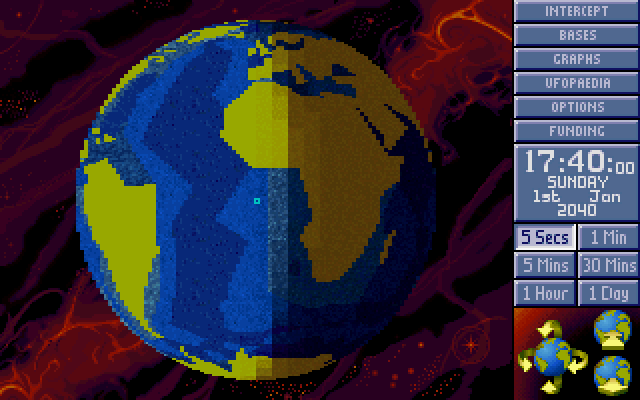](project_docs/scr/geo_globe.png)<br>Глобус на закате: тень по времени суток | [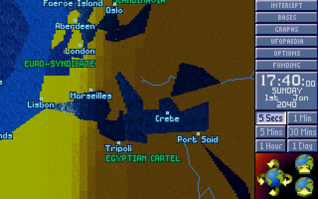](project_docs/scr/geo_cities.png)<br>Ближний зум: города, реки, подписи стран |
| [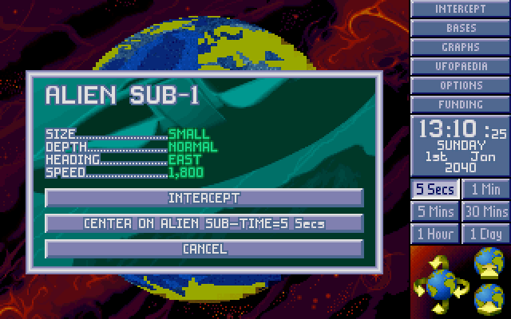](project_docs/scr/geo_ufo.png)<br>Обнаружена подлодка пришельцев | [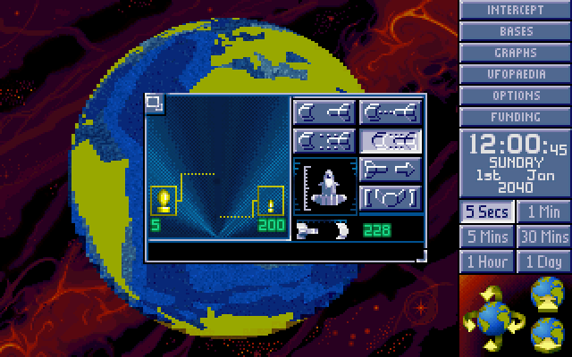](project_docs/scr/geo_dogfight.png)<br>Перехват: бой с USO |

### Базы

| | |
|---|---|
| [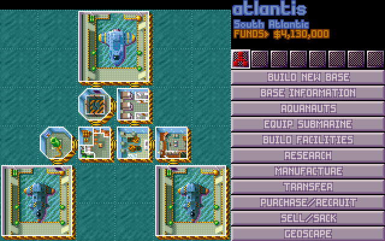](project_docs/scr/base_view.png)<br>База | [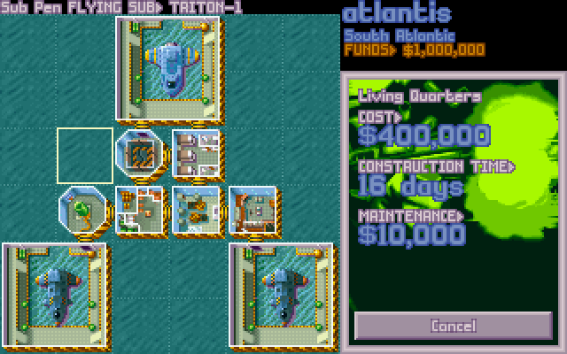](project_docs/scr/base_build.png)<br>Строительство: рамка габаритов модуля |
| [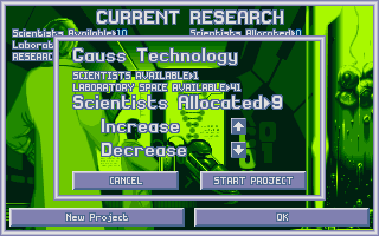](project_docs/scr/base_research.png)<br>Исследования: распределение учёных | [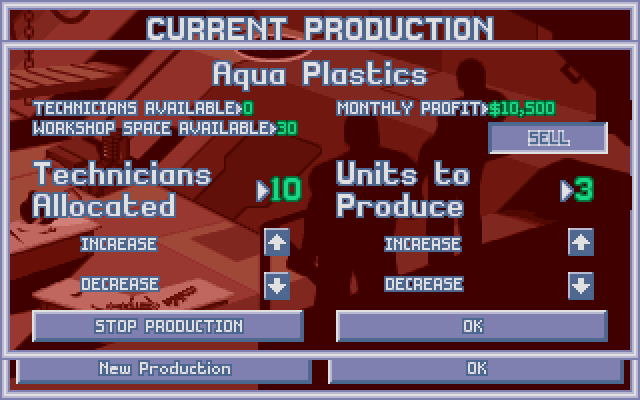](project_docs/scr/base_manufacture.png)<br>Производство |

### Экипаж и наземный бой

| | |
|---|---|
| [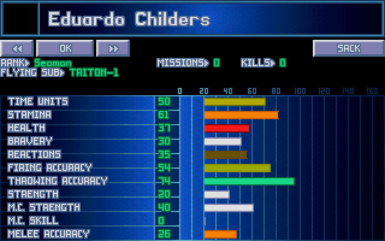](project_docs/scr/crew_soldier.png)<br>Карточка бойца | [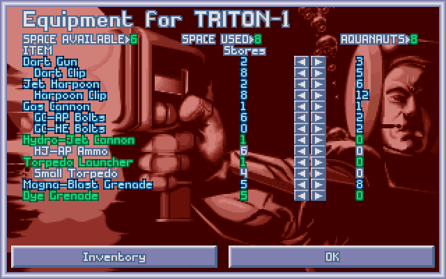](project_docs/scr/crew_equipment.png)<br>Снаряжение корабля |
| [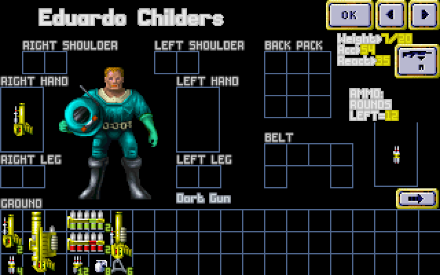](project_docs/scr/crew_inventory.png)<br>Инвентарь бойца: оружие заряжено, обойма под курсором | [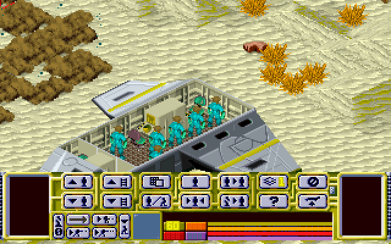](project_docs/scr/crew_battle.png)<br>Наземный бой: отряд в «Тритоне» |

### Уфопедия и отчёты

| | |
|---|---|
| [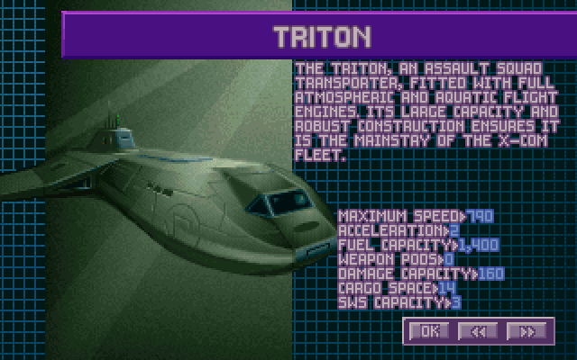](project_docs/scr/info_craft.png)<br>Уфопедия: корабль | [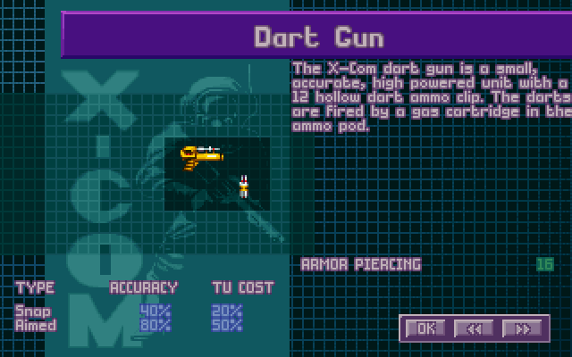](project_docs/scr/info_weapon.png)<br>Уфопедия: оружие |
| [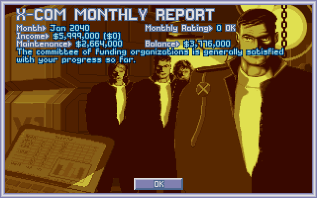](project_docs/scr/info_report.png)<br>Отчёт за месяц | [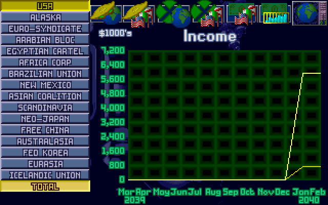](project_docs/scr/info_graphs.png)<br>Графики: доход по странам |

### X-COM: UFO Defense

Тот же код, данные из UFO Defense: правила, палитры и цвета интерфейса — свои у каждой игры.

| | |
|---|---|
| [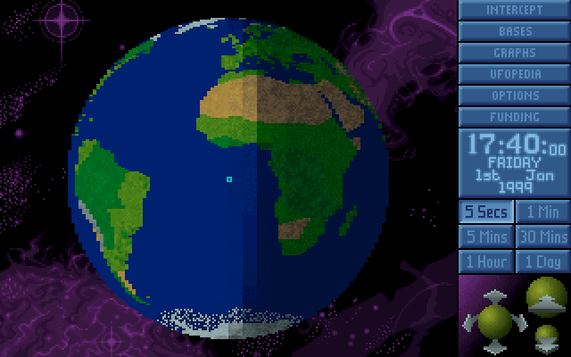](project_docs/scr/ufo_globe.png)<br>Геоскейп | [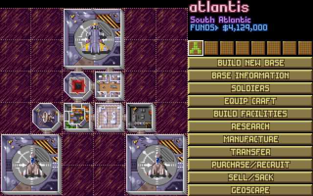](project_docs/scr/ufo_base.png)<br>База |
| [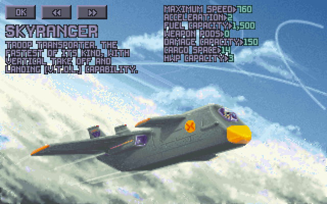](project_docs/scr/ufo_article.png)<br>Уфопедия | [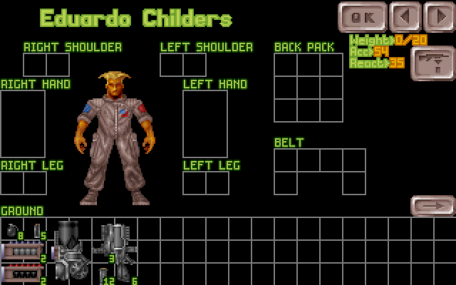](project_docs/scr/ufo_inventory.png)<br>Инвентарь бойца |

## Что уже работает

| Часть | Состояние |
|---|---|
| Геоскейп | глобус с тенью, реками, городами и метками (шесть зумов, ускорен под 14 МГц), время, обнаружение и полёты НЛО, перехват, воздушный бой (до четырёх сразу), места миссий и базы пришельцев, конец месяца, счёт и концовки |
| Базы | строительство, склад, закупки и продажа, переводы, исследования и производство, экономика, оборона базы |
| Экипаж | бойцы, корабли и их оружие, броня, снаряжение корабля, инвентарь бойца (раскладка, зарядка и разрядка оружия) |
| Уфопедия | статьи всех разделов, графики, отчёты |
| Наземный бой | генератор карты по `mapScript`, отрисовка изометрии, отряд с корабля, ходьба с учётом стен, дверей и этажей, приседание, панель |
| Сохранения | в эмуляторе — в файлы; на железе — в памяти до выключения, запись на SD-карту в работе |
| Звук | музыка четырьмя способами вывода, конвертер из ADLIB/MIDI |
| Железо | данные читаются с SD-карты FAT32 через DMA; игра запускается на настоящем ZX Evolution |

Чего пока нет: пришельцы и стрельба в бою, видимость и туман войны, разбор после
боя, звуковые эффекты. Подробный список — [project_docs/14_todo.md](project_docs/14_todo.md).

## Сборка

Нужны:

- **SDCC 4.5** (`sdcc`, `sdasz80`, `sdldz80` в `PATH`);
- **Node.js** — скрипты сборки и проверки;
- **.NET Framework 4.8** — конвертер данных `OxzConv` (C#);
- копия **X-COM: UFO Defense** или **Terror from the Deep** (например, из Steam)
  в каталоге `Steam/` — данные игры, они не распространяются;
- эмулятор **Unreal Speccy** с поддержкой TS-Config — для запуска и тестов.

```powershell
powershell -File tools\build.ps1              # TFTD (по умолчанию)
powershell -File tools\build.ps1 -Game UFO    # UFO
```

Сборка собирает ядро и банки, гоняет проверки раскладки памяти, конвертирует данные
игры и делает образ SD-карты. Результат — `tmp\build\oxz.spg`.

```powershell
powershell -File tools\run.ps1                # запустить в эмуляторе
powershell -File tools\runtests.ps1           # все автотесты
powershell -File tools\readme_shots.ps1       # снимки для этой страницы
```

Автотесты — сценарии в `tests\*.oxs`: эмулятор проигрывает нажатия, сверяет память
и делает снимки экрана. Код выхода 0 — тест прошёл.

## На настоящем железе

`powershell -File tools\dist.ps1` собирает обе игры и раскладывает содержимое карты
в `distr\` (игры, данные `OXZ\`, загрузчик Wild Commander), а образ — в `oxz_card.img`.
Карта — один раздел **FAT32** (с FAT16 TS-BIOS не грузится), содержимое `distr\` —
в корень. Подробно — [project_docs/23_distribution.md](project_docs/23_distribution.md).

## Из чего состоит

| Каталог | Что внутри |
|---|---|
| `src/kernel/` | ядро: старт, прерывания, страницы, дальняя память, ресурсы, текст, SD-карта (Win0 — только ассемблер) |
| `src/common/` | интерфейс, общий для геоскейпа и боя: виджеты, меню, Уфопедия |
| `src/geoscape/` | кампания: время, месяц, сохранение; `earth/` — глобус, окна геоскейпа, НЛО и корабли; `base/` — базы, лаборатория, производство, экономика, инвентарь |
| `src/battlescape/` | наземный бой: генератор карты, отрисовка, бойцы, поиск пути, двери |
| `OxzConv/` | конвертер данных игры в формат порта (C#) |
| `tools/` | сборка, запуск, тесты, замеры, вспомогательные скрипты |
| `tests/` | сценарии автотестов |
| `project_docs/` | вся проектная документация — [оглавление](project_docs/README.md) |

Код на C собирается в банки по 16 КБ (`tools\build.ps1`, массив `$banks`),
раскладка памяти описана в [src/map.h](src/map.h) и
[project_docs/08_ui_port_plan.md](project_docs/08_ui_port_plan.md) §4.

## Происхождение

Порт написан по исходникам [OpenXcom](https://github.com/OpenXcom/OpenXcom)
(GPL-3.0) — открытой реализации движка X-COM. Оригинальные данные игры
(графика, звук, тексты) принадлежат правообладателям и в репозиторий не входят:
их нужно взять из своей копии игры.
