# OpenXComZX

Порт **OpenXcom** (X-COM: UFO Defense и Terror from the Deep) на **TS-Config** —
ZX Evolution / Pentevo: Z80 до 14 МГц, 4 МБ страничной памяти, аппаратные тайлы,
спрайты и DMA. Музыка — AY / TurboSound / YM2203, опционально плата OPL3 (YMF262).

Порт сильно адаптирован под железо, но повторяет оригинал: те же правила, те же
формулы, те же мелочи интерфейса. Данные берутся из копии игры пользователя —
их конвертирует утилита на ПК, в репозитории оригинальных данных нет.

## Как это выглядит

Кадры 320×200 из эмулятора, увеличены вдвое без сглаживания. В каждой строке — одно и то же
место игры: слева X-COM: UFO Defense, справа X-COM: Terror from the Deep. Код один, данные —
свои у каждой игры (правила, палитры, цвета интерфейса). Снимки делает
`tools\readme_shots.ps1` из автотестов, так что они всегда соответствуют текущей сборке.

### Геоскейп

#### Начало игры

| UFO Defense | Terror from the Deep |
|---|---|
| [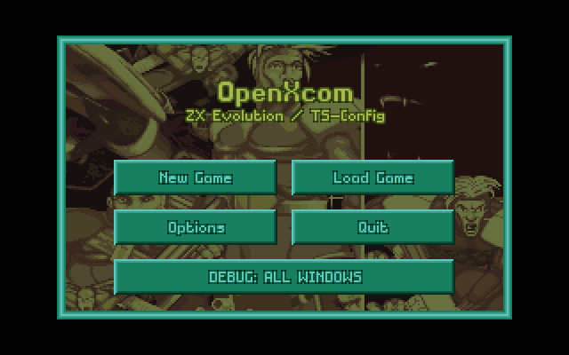](project_docs/scr/ufo_geo_menu.png)<br>Главное меню | [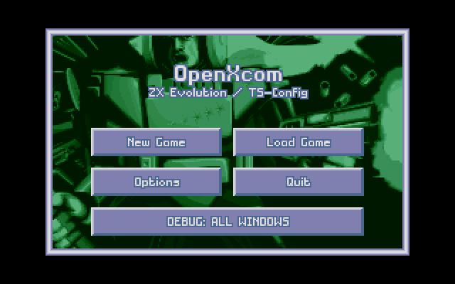](project_docs/scr/tftd_geo_menu.png)<br>Главное меню |
| [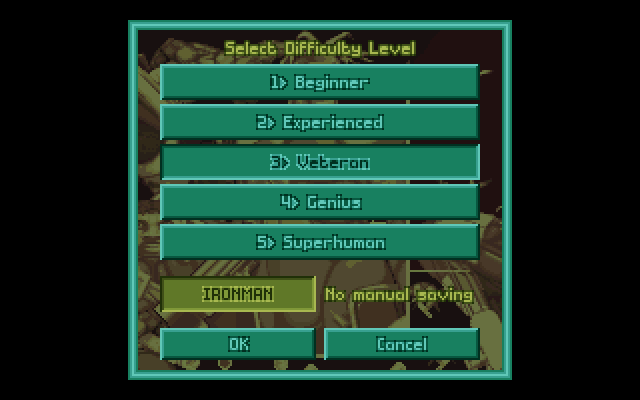](project_docs/scr/ufo_geo_newgame.png)<br>Новая игра: сложность и «железный человек» | [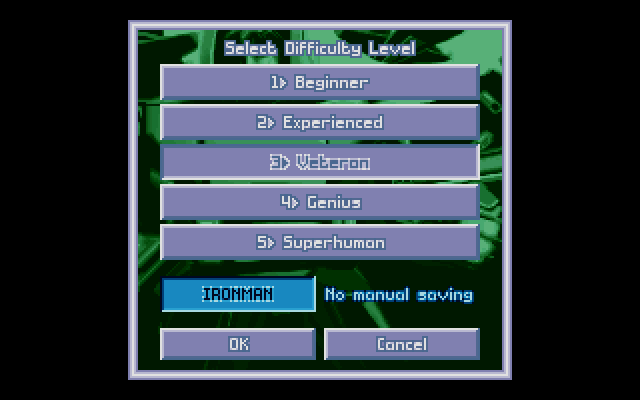](project_docs/scr/tftd_geo_newgame.png)<br>Новая игра: сложность и «железный человек» |

#### Глобус

| UFO Defense | Terror from the Deep |
|---|---|
| [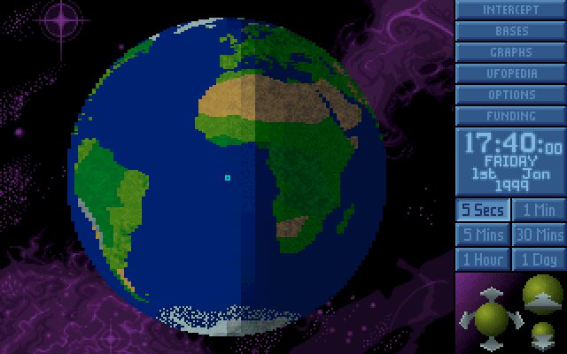](project_docs/scr/ufo_geo_globe.png)<br>Глобус на закате: тень по времени суток | [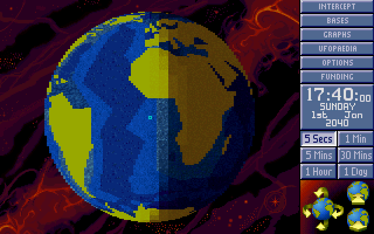](project_docs/scr/tftd_geo_globe.png)<br>Глобус на закате: тень по времени суток |
| [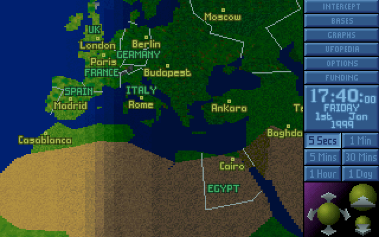](project_docs/scr/ufo_geo_cities.png)<br>Ближний зум: города, реки, подписи стран | [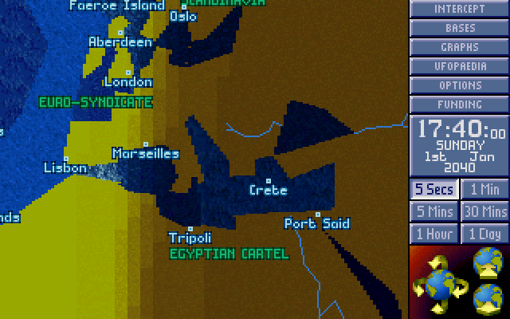](project_docs/scr/tftd_geo_cities.png)<br>Ближний зум: города, реки, подписи стран |

#### Первая база и сообщения

| UFO Defense | Terror from the Deep |
|---|---|
| [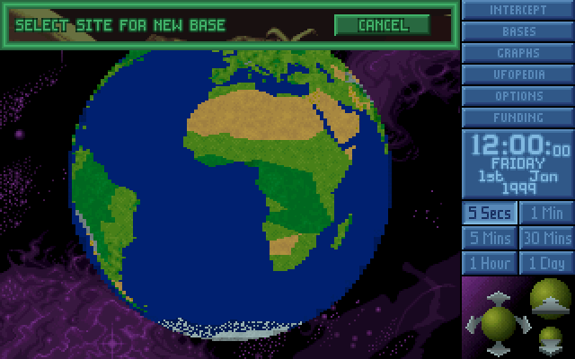](project_docs/scr/ufo_geo_first_base.png)<br>Место для первой базы | [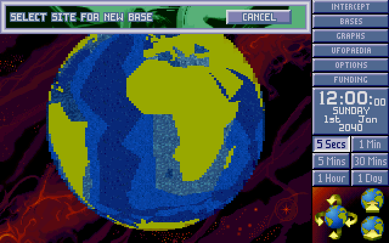](project_docs/scr/tftd_geo_first_base.png)<br>Место для первой базы |
| [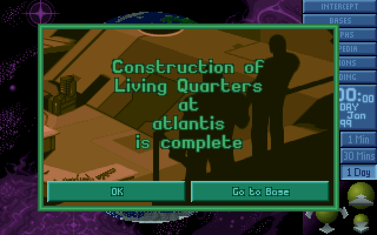](project_docs/scr/ufo_geo_message.png)<br>Сообщение: постройка закончена | [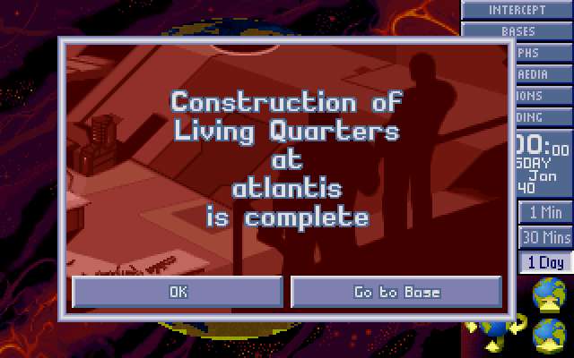](project_docs/scr/tftd_geo_message.png)<br>Сообщение: постройка закончена |

#### НЛО

| UFO Defense | Terror from the Deep |
|---|---|
| [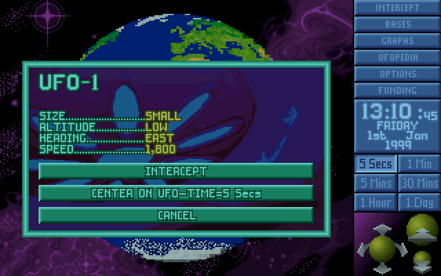](project_docs/scr/ufo_geo_ufo.png)<br>Обнаружен корабль пришельцев | [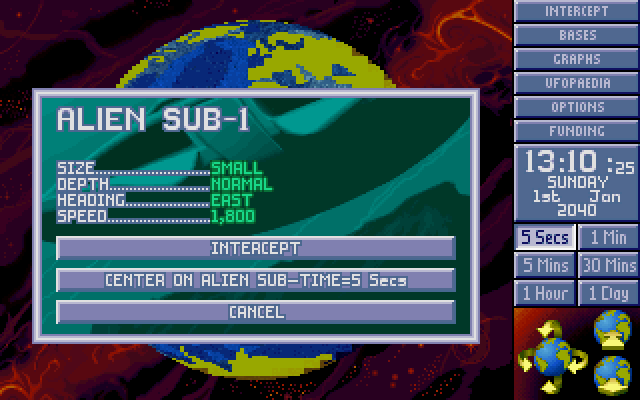](project_docs/scr/tftd_geo_ufo.png)<br>Обнаружен корабль пришельцев |
| [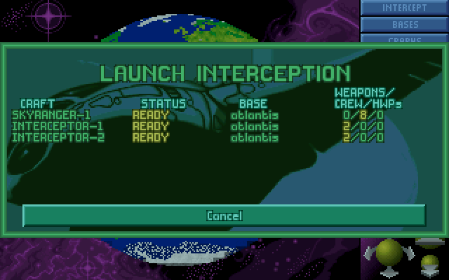](project_docs/scr/ufo_geo_intercept.png)<br>Перехват: выбор корабля | [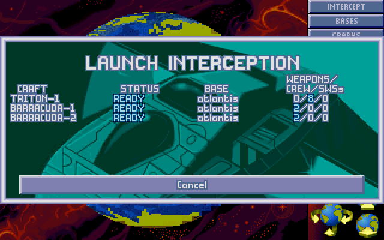](project_docs/scr/tftd_geo_intercept.png)<br>Перехват: выбор корабля |

#### Воздушный бой и оборона базы

| UFO Defense | Terror from the Deep |
|---|---|
| [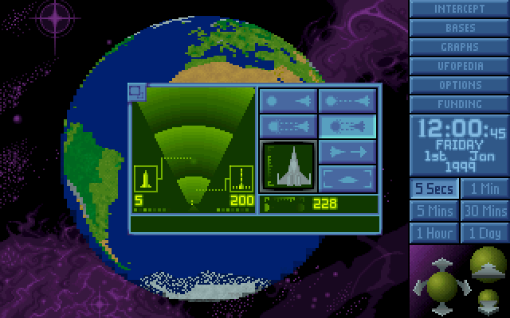](project_docs/scr/ufo_geo_dogfight.png)<br>Воздушный бой | [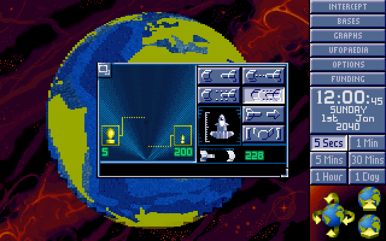](project_docs/scr/tftd_geo_dogfight.png)<br>Воздушный бой |
| [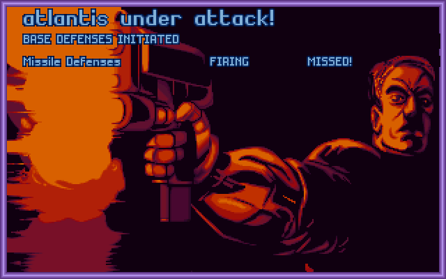](project_docs/scr/ufo_geo_basedefense.png)<br>Пришельцы атакуют базу: огонь обороны | [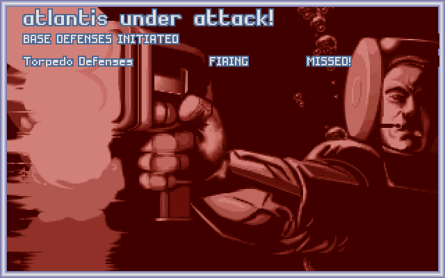](project_docs/scr/tftd_geo_basedefense.png)<br>Пришельцы атакуют базу: огонь обороны |

### Базы

#### База

| UFO Defense | Terror from the Deep |
|---|---|
| [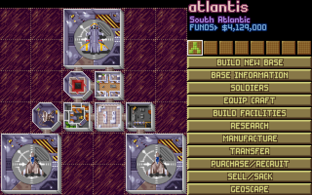](project_docs/scr/ufo_base_view.png)<br>База | [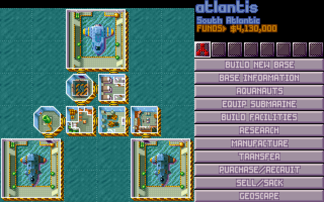](project_docs/scr/tftd_base_view.png)<br>База |
| [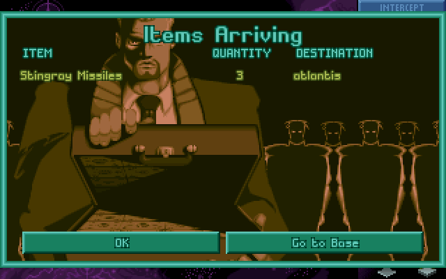](project_docs/scr/ufo_base_arriving.png)<br>Прибыли закупки | [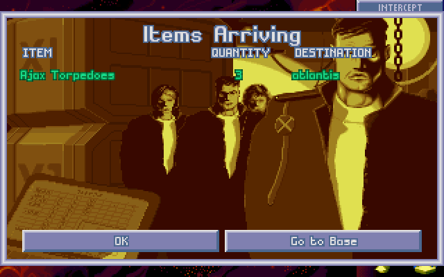](project_docs/scr/tftd_base_arriving.png)<br>Прибыли закупки |

#### Строительство

| UFO Defense | Terror from the Deep |
|---|---|
| [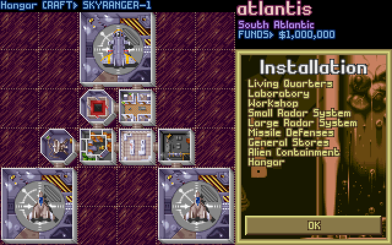](project_docs/scr/ufo_base_build_list.png)<br>Список построек | [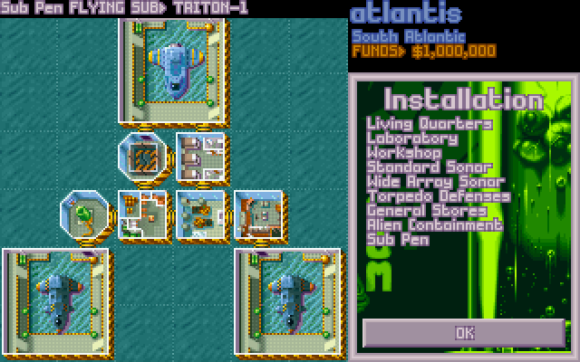](project_docs/scr/tftd_base_build_list.png)<br>Список построек |
| [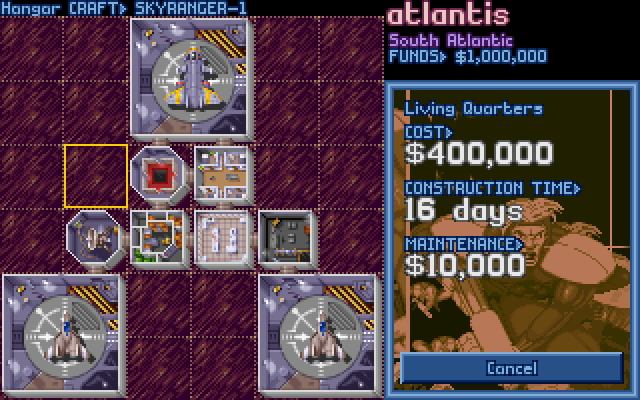](project_docs/scr/ufo_base_build.png)<br>Рамка габаритов модуля, цена и срок | [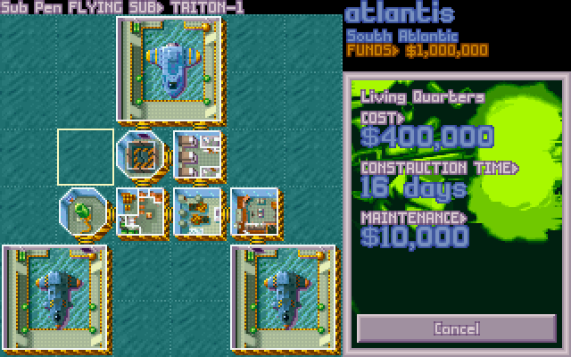](project_docs/scr/tftd_base_build.png)<br>Рамка габаритов модуля, цена и срок |

#### Исследования

| UFO Defense | Terror from the Deep |
|---|---|
| [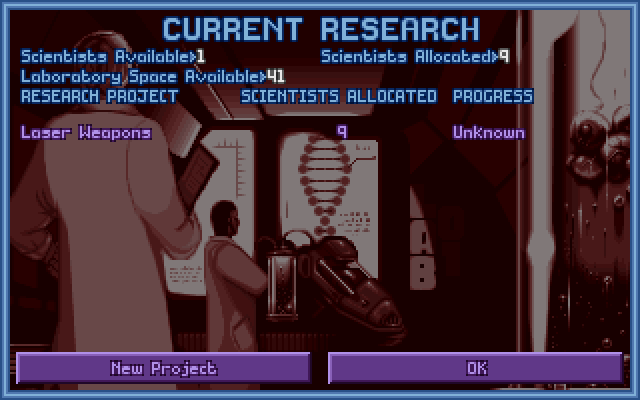](project_docs/scr/ufo_base_research_list.png)<br>Текущие исследования | [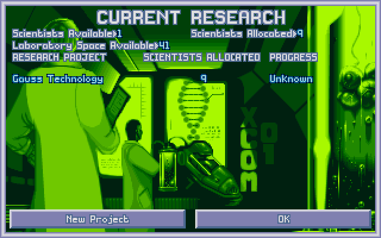](project_docs/scr/tftd_base_research_list.png)<br>Текущие исследования |
| [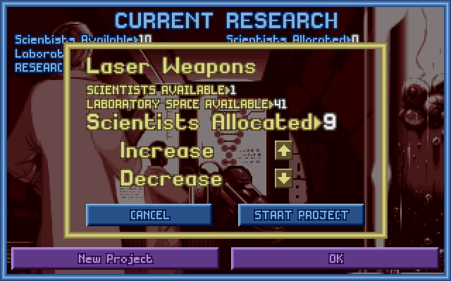](project_docs/scr/ufo_base_research.png)<br>Распределение учёных | [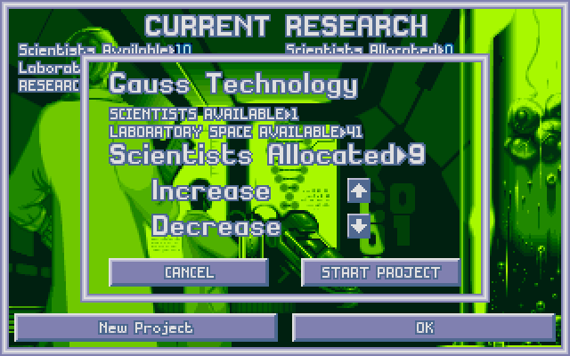](project_docs/scr/tftd_base_research.png)<br>Распределение учёных |

#### Производство

| UFO Defense | Terror from the Deep |
|---|---|
| [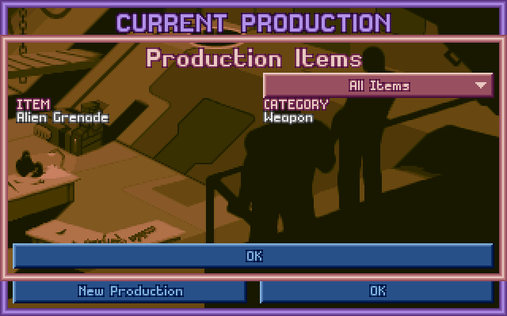](project_docs/scr/ufo_base_manuf_list.png)<br>Что можно производить | [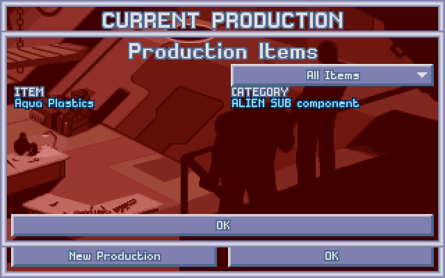](project_docs/scr/tftd_base_manuf_list.png)<br>Что можно производить |
| [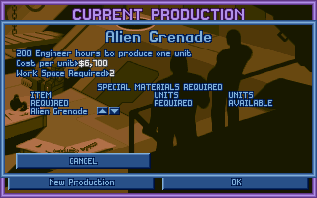](project_docs/scr/ufo_base_manufacture.png)<br>Запуск производства | [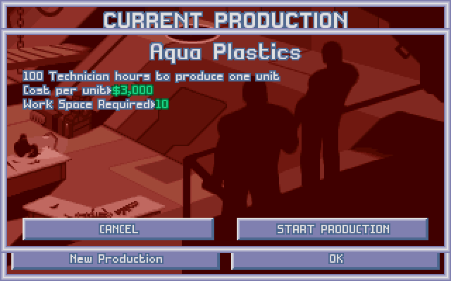](project_docs/scr/tftd_base_manufacture.png)<br>Запуск производства |

#### Склад и переводы

| UFO Defense | Terror from the Deep |
|---|---|
| [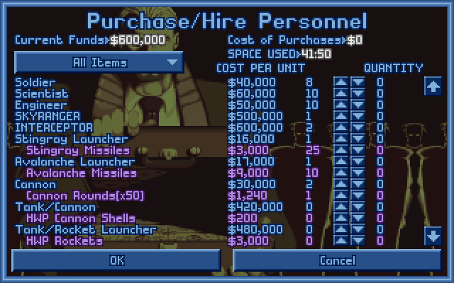](project_docs/scr/ufo_base_purchase.png)<br>Закупки и наём | [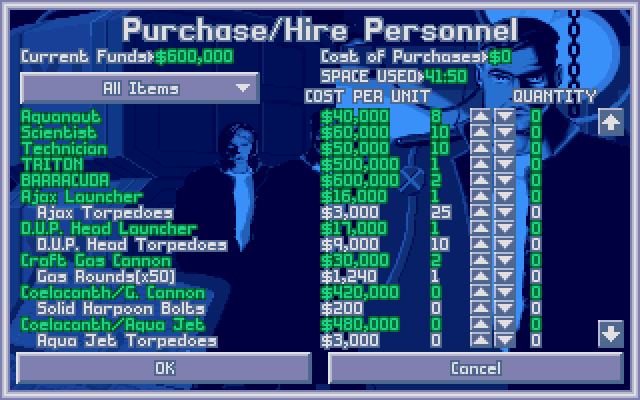](project_docs/scr/tftd_base_purchase.png)<br>Закупки и наём |
| [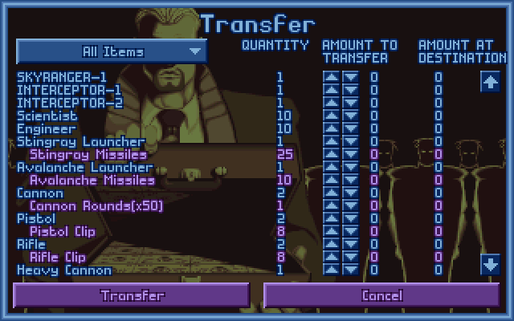](project_docs/scr/ufo_base_transfer.png)<br>Перевод между базами | [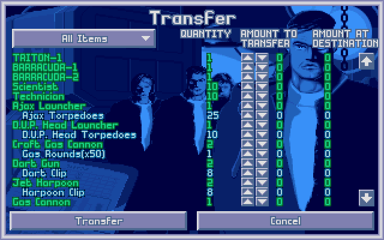](project_docs/scr/tftd_base_transfer.png)<br>Перевод между базами |

### Экипаж

#### Бойцы

| UFO Defense | Terror from the Deep |
|---|---|
| [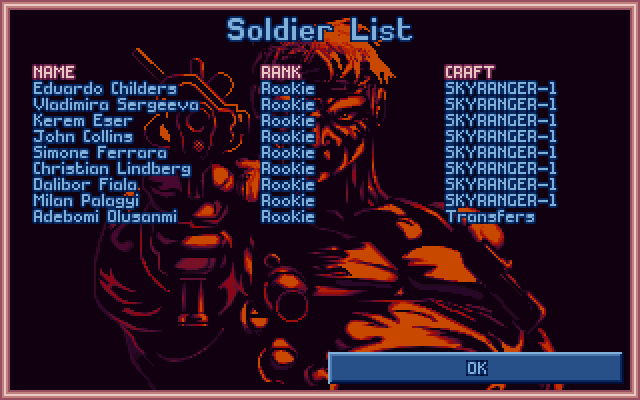](project_docs/scr/ufo_crew_list.png)<br>Список бойцов | [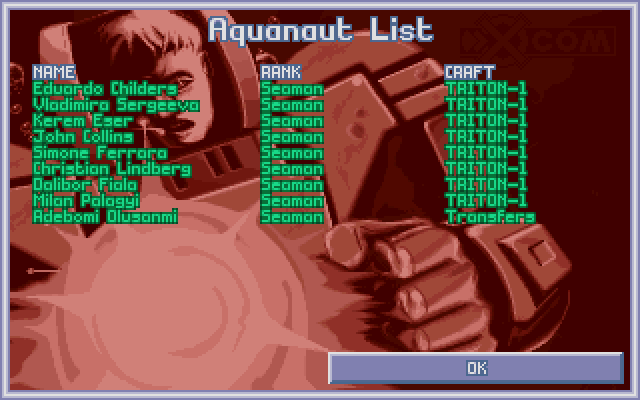](project_docs/scr/tftd_crew_list.png)<br>Список бойцов |
| [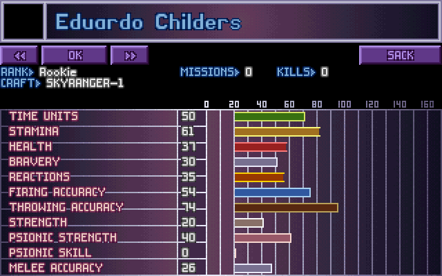](project_docs/scr/ufo_crew_soldier.png)<br>Карточка бойца | [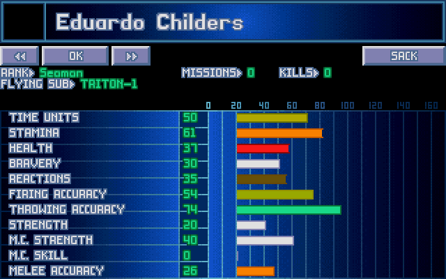](project_docs/scr/tftd_crew_soldier.png)<br>Карточка бойца |

#### Корабль

| UFO Defense | Terror from the Deep |
|---|---|
| [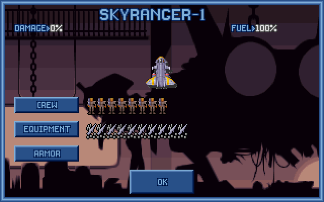](project_docs/scr/ufo_crew_craft.png)<br>Корабль: экипаж, снаряжение, броня | [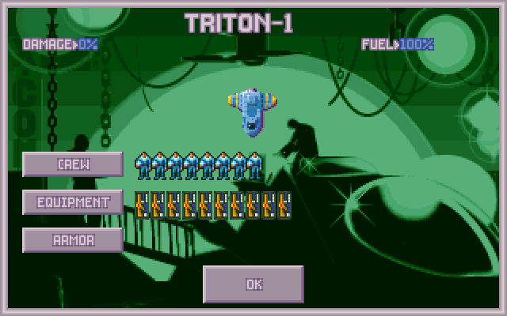](project_docs/scr/tftd_crew_craft.png)<br>Корабль: экипаж, снаряжение, броня |
| [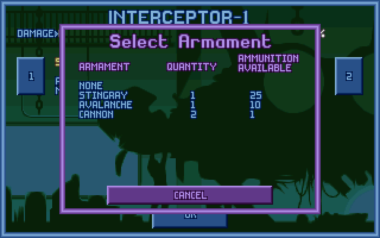](project_docs/scr/ufo_crew_craft_weapons.png)<br>Вооружение корабля | [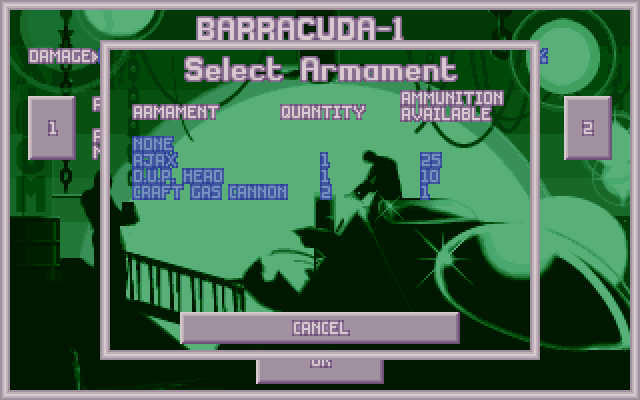](project_docs/scr/tftd_crew_craft_weapons.png)<br>Вооружение корабля |

#### Снаряжение и инвентарь

| UFO Defense | Terror from the Deep |
|---|---|
| [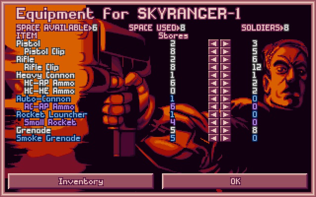](project_docs/scr/ufo_crew_equipment.png)<br>Снаряжение корабля | [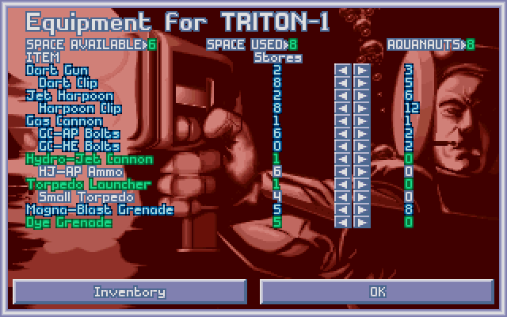](project_docs/scr/tftd_crew_equipment.png)<br>Снаряжение корабля |
| [](project_docs/scr/ufo_crew_inventory.png)<br>Инвентарь: оружие заряжено, обойма под курсором | [](project_docs/scr/tftd_crew_inventory.png)<br>Инвентарь: оружие заряжено, обойма под курсором |

### Наземный бой

По ходу миссии: от брифинга до разбора.

#### Высадка

| UFO Defense | Terror from the Deep |
|---|---|
| [](project_docs/scr/ufo_bat_briefing.png)<br>Брифинг перед высадкой | [](project_docs/scr/tftd_bat_briefing.png)<br>Брифинг перед высадкой |
| [](project_docs/scr/ufo_bat_landing.png)<br>Отряд на поле боя | [](project_docs/scr/tftd_bat_landing.png)<br>Отряд на поле боя |

#### Карта

| UFO Defense | Terror from the Deep |
|---|---|
| [](project_docs/scr/ufo_bat_craft.png)<br>Корабль отряда снаружи, этажи | [](project_docs/scr/tftd_bat_craft.png)<br>Корабль отряда снаружи, этажи |
| [](project_docs/scr/ufo_bat_door.png)<br>Дверь открыта | [](project_docs/scr/tftd_bat_door.png)<br>Дверь открыта |

#### Разведка

| UFO Defense | Terror from the Deep |
|---|---|
| [](project_docs/scr/ufo_bat_fog.png)<br>Туман войны: открыто только то, что видел отряд | [](project_docs/scr/tftd_bat_fog.png)<br>Туман войны: открыто только то, что видел отряд |
| [](project_docs/scr/ufo_bat_aim.png)<br>Пришелец замечен: значок справа над панелью | [](project_docs/scr/tftd_bat_aim.png)<br>Пришелец замечен: значок справа над панелью |

#### Действия

| UFO Defense | Terror from the Deep |
|---|---|
| [](project_docs/scr/ufo_bat_menu.png)<br>Меню действий: точность и цена в единицах времени | [](project_docs/scr/tftd_bat_menu.png)<br>Меню действий: точность и цена в единицах времени |
| [](project_docs/scr/ufo_bat_melee.png)<br>Ближний бой: оглушить | [](project_docs/scr/tftd_bat_melee.png)<br>Ближний бой: оглушить |

#### Гранаты

| UFO Defense | Terror from the Deep |
|---|---|
| [](project_docs/scr/ufo_bat_grenade.png)<br>Таймер взрывателя | [](project_docs/scr/tftd_bat_grenade.png)<br>Таймер взрывателя |
| [](project_docs/scr/ufo_bat_throw.png)<br>Бросок: выбор клетки | [](project_docs/scr/tftd_bat_throw.png)<br>Бросок: выбор клетки |

#### Бойцы

| UFO Defense | Terror from the Deep |
|---|---|
| [](project_docs/scr/ufo_bat_stats.png)<br>Характеристики бойца в бою | [](project_docs/scr/tftd_bat_stats.png)<br>Характеристики бойца в бою |
| [](project_docs/scr/ufo_bat_inventory.png)<br>Инвентарь в бою | [](project_docs/scr/tftd_bat_inventory.png)<br>Инвентарь в бою |

#### Раненые и пси

| UFO Defense | Terror from the Deep |
|---|---|
| [](project_docs/scr/ufo_bat_medikit.png)<br>Аптечка: раны по частям тела | [](project_docs/scr/tftd_bat_medikit.png)<br>Аптечка: раны по частям тела |
| [](project_docs/scr/ufo_bat_mindcontrol.png)<br>Контроль разума: пришелец ходит за X-COM | [](project_docs/scr/tftd_bat_mindcontrol.png)<br>Контроль разума: пришелец ходит за X-COM |

#### Ход и пауза

| UFO Defense | Terror from the Deep |
|---|---|
| [](project_docs/scr/ufo_bat_turn.png)<br>Ход пришельцев | [](project_docs/scr/tftd_bat_turn.png)<br>Ход пришельцев |
| [](project_docs/scr/ufo_bat_pause.png)<br>Меню паузы | [](project_docs/scr/tftd_bat_pause.png)<br>Меню паузы |

#### Панель

| UFO Defense | Terror from the Deep |
|---|---|
| [](project_docs/scr/ufo_bat_warn.png)<br>Не хватает единиц времени | [](project_docs/scr/tftd_bat_warn.png)<br>Не хватает единиц времени |
| [](project_docs/scr/ufo_bat_kneel.png)<br>Боец присел | [](project_docs/scr/tftd_bat_kneel.png)<br>Боец присел |

#### Конец миссии

| UFO Defense | Terror from the Deep |
|---|---|
| [](project_docs/scr/ufo_bat_abort.png)<br>Прервать миссию: кто в корабле, кто снаружи | [](project_docs/scr/tftd_bat_abort.png)<br>Прервать миссию: кто в корабле, кто снаружи |
| [](project_docs/scr/ufo_bat_debriefing.png)<br>Разбор: счёт и трофеи | [](project_docs/scr/tftd_bat_debriefing.png)<br>Разбор: счёт и трофеи |

### Уфопедия и отчёты

#### Уфопедия

| UFO Defense | Terror from the Deep |
|---|---|
| [](project_docs/scr/ufo_info_ufopaedia.png)<br>Разделы Уфопедии | [](project_docs/scr/tftd_info_ufopaedia.png)<br>Разделы Уфопедии |
| [](project_docs/scr/ufo_info_article.png)<br>Статья о корабле | [](project_docs/scr/tftd_info_article.png)<br>Статья о корабле |

#### Оружие

| UFO Defense | Terror from the Deep |
|---|---|
| [](project_docs/scr/ufo_info_weapon.png)<br>Оружие X-COM | [](project_docs/scr/tftd_info_weapon.png)<br>Оружие X-COM |
| [](project_docs/scr/ufo_info_weapon2.png)<br>Оружие на технологиях пришельцев | [](project_docs/scr/tftd_info_weapon2.png)<br>Оружие на технологиях пришельцев |

#### Пришельцы

| UFO Defense | Terror from the Deep |
|---|---|
| [](project_docs/scr/ufo_info_alien.png)<br>Раса пришельцев | [](project_docs/scr/tftd_info_alien.png)<br>Раса пришельцев |
| [](project_docs/scr/ufo_info_tech.png)<br>Технология пришельцев | [](project_docs/scr/tftd_info_tech.png)<br>Технология пришельцев |

#### Отчёты

| UFO Defense | Terror from the Deep |
|---|---|
| [](project_docs/scr/ufo_info_report.png)<br>Отчёт за месяц | [](project_docs/scr/tftd_info_report.png)<br>Отчёт за месяц |
| [](project_docs/scr/ufo_info_funding.png)<br>Финансирование стран | [](project_docs/scr/tftd_info_funding.png)<br>Финансирование стран |

#### Графики

| UFO Defense | Terror from the Deep |
|---|---|
| [](project_docs/scr/ufo_info_graphs.png)<br>Активность пришельцев по регионам | [](project_docs/scr/tftd_info_graphs.png)<br>Активность пришельцев по регионам |
| [](project_docs/scr/ufo_info_finance.png)<br>Финансы | [](project_docs/scr/tftd_info_finance.png)<br>Финансы |

## Что уже работает

| Часть | Состояние |
|---|---|
| Геоскейп | глобус с тенью, реками, городами и метками (шесть зумов, ускорен под 14 МГц), время, обнаружение и полёты НЛО, перехват, воздушный бой (до четырёх сразу), места миссий и базы пришельцев, конец месяца, счёт и концовки |
| Базы | строительство, склад, закупки и продажа, переводы, исследования и производство, экономика, оборона базы |
| Экипаж | бойцы, корабли и их оружие, броня, снаряжение корабля, инвентарь бойца (раскладка, зарядка и разрядка оружия) |
| Уфопедия | статьи всех разделов, графики, отчёты |
| Наземный бой | генератор карты по `mapScript`, изометрия, ходьба с учётом стен, дверей и этажей; брифинг, инвентарь перед высадкой; пришельцы с ИИ (патруль, огонь, гранаты, ближний бой, пси-атаки), мирные жители; стрельба и броски, огонь в ответ, туман войны, взрывы и разрушение местности, раны, оглушение, паника, аптечка, пси-усилитель и контроль разума; многофазные миссии, разбор, повышения |
| Сохранения | в эмуляторе — в файлы; на железе — в памяти до выключения, запись на SD-карту в работе |
| Звук | музыка четырьмя способами вывода, конвертер из ADLIB/MIDI |
| Железо | данные читаются с SD-карты FAT32 через DMA; игра запускается на настоящем ZX Evolution |

Чего пока нет: ночь и дым в бою, сохранение посреди боя, наземная оборона базы,
звуковые эффекты. Подробный список — [project_docs/14_todo.md](project_docs/14_todo.md).

## Сборка

Нужны:

- **SDCC 4.5** (`sdcc`, `sdasz80`, `sdldz80` в `PATH`);
- **Node.js** — скрипты сборки и проверки;
- **.NET Framework 4.8** — конвертер данных `OxzConv` (C#);
- копия **X-COM: UFO Defense** или **Terror from the Deep** (например, из Steam)
  в каталоге `Steam/` — данные игры, они не распространяются;
- эмулятор **Unreal Speccy** с поддержкой TS-Config — для запуска и тестов.

```powershell
powershell -File tools\build.ps1              # TFTD (по умолчанию)
powershell -File tools\build.ps1 -Game UFO    # UFO
```

Сборка собирает ядро и банки, гоняет проверки раскладки памяти, конвертирует данные
игры и делает образ SD-карты. Результат — `tmp\build\oxz.spg`.

```powershell
powershell -File tools\run.ps1                # запустить в эмуляторе
powershell -File tools\runtests.ps1           # все автотесты
powershell -File tools\readme_shots.ps1       # снимки для этой страницы
```

Автотесты — сценарии в `tests\*.oxs`: эмулятор проигрывает нажатия, сверяет память
и делает снимки экрана. Код выхода 0 — тест прошёл.

## На настоящем железе

`powershell -File tools\dist.ps1` собирает обе игры и раскладывает содержимое карты
в `distr\` (игры, данные `OXZ\`, загрузчик Wild Commander), а образ — в `oxz_card.img`.
Карта — один раздел **FAT32** (с FAT16 TS-BIOS не грузится), содержимое `distr\` —
в корень. Подробно — [project_docs/23_distribution.md](project_docs/23_distribution.md).

## Из чего состоит

| Каталог | Что внутри |
|---|---|
| `src/kernel/` | ядро: старт, прерывания, страницы, дальняя память, ресурсы, текст, SD-карта (Win0 — только ассемблер) |
| `src/common/` | интерфейс, общий для геоскейпа и боя: виджеты, меню, Уфопедия |
| `src/geoscape/` | кампания: время, месяц, сохранение; `earth/` — глобус, окна геоскейпа, НЛО и корабли; `base/` — базы, лаборатория, производство, экономика, инвентарь |
| `src/battlescape/` | наземный бой: генератор карты, отрисовка, бойцы, поиск пути, двери |
| `OxzConv/` | конвертер данных игры в формат порта (C#) |
| `tools/` | сборка, запуск, тесты, замеры, вспомогательные скрипты |
| `tests/` | сценарии автотестов |
| `project_docs/` | вся проектная документация — [оглавление](project_docs/README.md) |

Код на C собирается в банки по 16 КБ (`tools\build.ps1`, массив `$banks`),
раскладка памяти описана в [src/map.h](src/map.h) и
[project_docs/08_ui_port_plan.md](project_docs/08_ui_port_plan.md) §4.

## Происхождение

Порт написан по исходникам [OpenXcom](https://github.com/OpenXcom/OpenXcom)
(GPL-3.0) — открытой реализации движка X-COM. Оригинальные данные игры
(графика, звук, тексты) принадлежат правообладателям и в репозиторий не входят:
их нужно взять из своей копии игры.
